<div align="center">

# Sparse-Sample Reconstruction of Crop Vigor Using Sentinel-2 NDVI

### A Preliminary Benchmark of IDW and Kriging for Precision Agriculture

**Classical geostatistics vs. five AI predictors under sparse field sampling**

[](#11-how-to-cite)
[](#11-how-to-cite)
[](#9-reproducing-the-study)
[](https://colab.research.google.com/github/allmamun556/Sparse-Sample-Reconstruction-of-Crop-Vigor-Using-Sentinel-2-NDVI/blob/main/precision_ag_spatial_interpolation_REVISED.ipynb)

**Mahbubul Alam**<sup>1,*</sup> · **Abdullah All Mamun**<sup>2</sup>

<sup>1</sup> Department of Forest Information Technology, Eberswalde University for Sustainable Development (HNEE), 16225 Eberswalde, Germany<br>
<sup>2</sup> Information and Communication Engineering, Berliner Hochschule für Technik (BHT), 13353 Berlin, Germany<br>
<sup>*</sup> Correspondence: u23112@hnee.de · Co-author: hvnn3504@bht-berlin.de

*The 6th International Electronic Conference on Remote Sensing (ECRS-6), Session S1 – AI in Remote Sensing, Sciforum-208035*

</div>

---

> **Key finding.** On a 98.1 ha arable parcel reconstructed from 20–200 noisy point samples, **ordinary kriging and inverse distance weighting (IDW) were the most reliable NDVI reconstructors** and were statistically indistinguishable from each other. **None of five AI-based predictors** (random forest, gradient boosting, Gaussian process, a Fourier-feature neural network and a random-forest + residual-kriging hybrid) **surpassed geostatistics at any tested sampling density.**

<p align="center">
  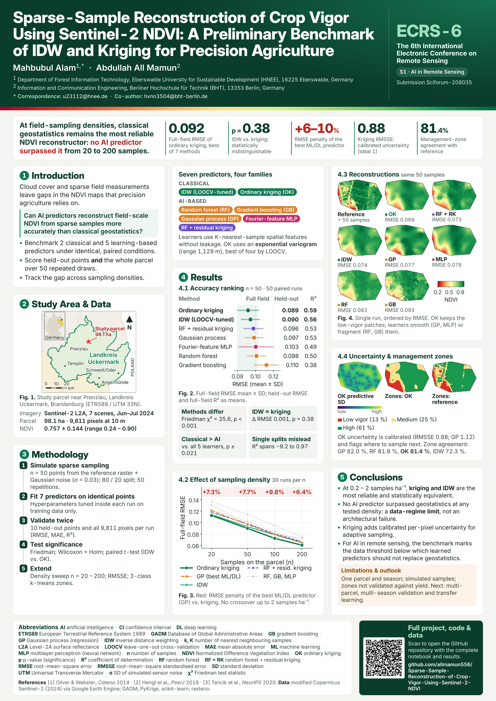
  <br><em>Conference poster (A0 portrait). Full-resolution PDF: <a href="poster/ECRS6_poster_A0.pdf">poster/ECRS6_poster_A0.pdf</a></em>
</p>

---

## Table of Contents

- [Highlights](#highlights)
- [Abstract](#abstract)
- [1. Introduction](#1-introduction)
- [2. Study Area and Data](#2-study-area-and-data)
- [3. Methodology](#3-methodology)
- [4. Results](#4-results)
- [5. Discussion](#5-discussion)
- [6. Conclusions](#6-conclusions)
- [7. Conference Poster](#7-conference-poster)
- [8. Repository Structure](#8-repository-structure)
- [9. Reproducing the Study](#9-reproducing-the-study)
- [10. Revision History and Response to Reviewers](#10-revision-history-and-response-to-reviewers)
- [11. How to Cite](#11-how-to-cite)
- [12. Acknowledgements and Data Sources](#12-acknowledgements-and-data-sources)
- [13. License](#13-license)
- [Abbreviations](#abbreviations)
- [References](#references)

---

## Highlights

| | Result | Value |
|---|---|---|
| 🥇 | Best method (mean full-field RMSE, 50 runs) | **Ordinary kriging, RMSE 0.092 ± 0.011, R² 0.586 ± 0.104** |
| ⚖️ | IDW vs. ordinary kriging (held-out RMSE) | Δ = +0.0014, 95 % CI [−0.0018, +0.0045], **paired *t* p = 0.38** → indistinguishable |
| 🧪 | Do the methods differ? | **Friedman χ² = 35.55, df = 6, p = 3.4 × 10⁻⁶** |
| 🤖 | IDW vs. each of the 5 learning-based predictors | **Significantly better in all 5 comparisons** (Wilcoxon, Holm-adjusted p ≤ 0.021) |
| 📉 | RMSE penalty of the best ML/DL predictor vs. best geostatistics | **+7.3 % (n = 20), +7.7 % (n = 50), +9.8 % (n = 100), +6.4 % (n = 200)**, no crossover up to 2 samples ha⁻¹ |
| 🎯 | Kriging uncertainty calibration | **RMSSE 0.88** (ideal = 1) |
| 🗺️ | Management-zone agreement (kriging vs. reference raster) | **81.4 %** of 9,811 pixels |

---

## Abstract

Sparse field measurements and frequent cloud cover continue to limit the availability of complete NDVI observations for precision agriculture. To address this constraint, this study evaluates how effectively both classical geostatistical interpolation and modern artificial-intelligence-based predictors can reconstruct full NDVI surfaces from limited point samples. A Sentinel-2 NDVI composite (10 m, June–July 2024) over a digitised 98.1 ha arable parcel in Uckermark, Brandenburg, Germany, serves as the reference dataset, with 9,811 in-field pixels retained after masking. Fifty sparse samples were generated by drawing points from the reference raster with added Gaussian sensor noise, and the sampling process was repeated 50 times to ensure robust evaluation. Two established geostatistical methods — inverse distance weighting and ordinary kriging — were benchmarked alongside five learning-based approaches: random forest, gradient boosting, Gaussian process regression, a coordinate-based neural network with random Fourier positional encoding, and a residual-kriging hybrid. The AI models were applied directly to the sparse NDVI samples to learn the relationship between spatial coordinates and NDVI values, enabling full-parcel predictions without relying on manually defined spatial structures. The neural network used Fourier features to encode spatial position, while the residual-kriging hybrid combined machine-learning predictions with kriging of residuals to capture the remaining spatial dependence. This dual-framework design provides a scientifically grounded comparison between manually parameterised geostatistical interpolators and data-driven AI models, addressing a central question in remote-sensing-based surface reconstruction: whether learned predictors can outperform classical methods under sparse-sampling constraints. All hyperparameters — including IDW power, neighbourhood size, variogram model, kernel choice, and encoding bandwidth — were selected within each repetition using training data only. The exponential variogram consistently outperformed spherical, Gaussian, and linear alternatives. Ordinary kriging achieved the lowest mean error (held-out RMSE 0.089 ± 0.035; full-field RMSE 0.092 ± 0.011; R² 0.586 ± 0.104), although its performance was statistically indistinguishable from inverse distance weighting (paired p = 0.38). Both geostatistical methods significantly outperformed all five AI-based predictors across sampling densities from 20 to 200 points. Kriging prediction variance demonstrated good calibration (RMSSE 0.88), and management-zone delineation using k-means clustering reproduced 81.4 % of reference-raster zones. The results indicate that, under sparse-sampling conditions, classical geostatistical interpolation remains more reliable than current AI-based predictors for NDVI surface reconstruction. Broader multi-parcel validation will be required to generalise performance across crop types, seasons, and sampling densities.

**Keywords:** precision agriculture; spatial interpolation; kriging; NDVI; Sentinel-2; management zones; machine learning; Gaussian process; Fourier features

---

## 1. Introduction

### 1.1 Background

Precision agriculture depends on spatially complete maps of crop vigor to guide variable-rate fertilisation, irrigation and scouting [[1]](#ref1). The Normalized Difference Vegetation Index (NDVI) derived from Sentinel-2 [[2]](#ref2) is the most widely used proxy for vigor, yet complete NDVI observations are frequently unavailable: clouds and cloud shadows mask parts of a scene, and ground-based measurements (handheld sensors, soil probes, scouting points) are collected only at a few locations per field. Before any management decision can be taken, a **continuous surface must be reconstructed from sparse, noisy point samples**.

Two families of methods compete for this task:

- **Classical spatial interpolation**: deterministic inverse distance weighting (IDW) [[4]](#ref4) and geostatistical ordinary kriging [[5]](#ref5), [[6]](#ref6), which encode spatial dependence explicitly through a distance-decay rule or a fitted variogram. Their relative performance is known to depend on data density and spatial structure [[20]](#ref20).
- **Learning-based (AI) predictors**: tree ensembles with spatial features [[7]](#ref7), [[8]](#ref8), [[11]](#ref11), Gaussian process regression [[9]](#ref9), coordinate-based neural networks with Fourier positional encoding [[10]](#ref10), and hybrids that krige machine-learning residuals.

### 1.2 Research question

> **Under sparse-sampling constraints typical of field campaigns, can data-driven AI predictors reconstruct a field-scale NDVI surface more accurately than classical geostatistical interpolation?**

### 1.3 Objectives

1. Benchmark **two classical** (IDW, ordinary kriging) and **five learning-based** predictors under identical, paired conditions on the same sample realisations.
2. Score accuracy both at **held-out points** and over **the entire parcel** (all 9,811 valid pixels), using **50 repeated sample draws** and formal significance testing instead of a single train/test split.
3. Determine whether, and at what **sampling density** (20–200 samples, 0.2–2.0 samples ha⁻¹), learned predictors overtake geostatistics.
4. Evaluate whether the reconstructed surfaces support **per-pixel uncertainty mapping** and **management-zone delineation**.

### 1.4 Relevance to AI in remote sensing

The study deliberately places five machine-learning and deep-learning predictors in a fair, leakage-controlled comparison with geostatistics. A negative result for the learners is informative: it **locates the data regime below which learned predictors should not replace geostatistical interpolation**, and motivates transfer-learning approaches that bring prior structure from many fields (see [§5.5](#55-limitations)).

---

## 2. Study Area and Data

### 2.1 Study area

The study parcel is an arable field near **Prenzlau, Landkreis Uckermark, Brandenburg, north-eastern Germany** (seed point 13.8360° E, 53.3335° N). Uckermark is a rural district dominated by large-scale arable farming, where within-field vigor variability is a practical management concern.

<p align="center">
  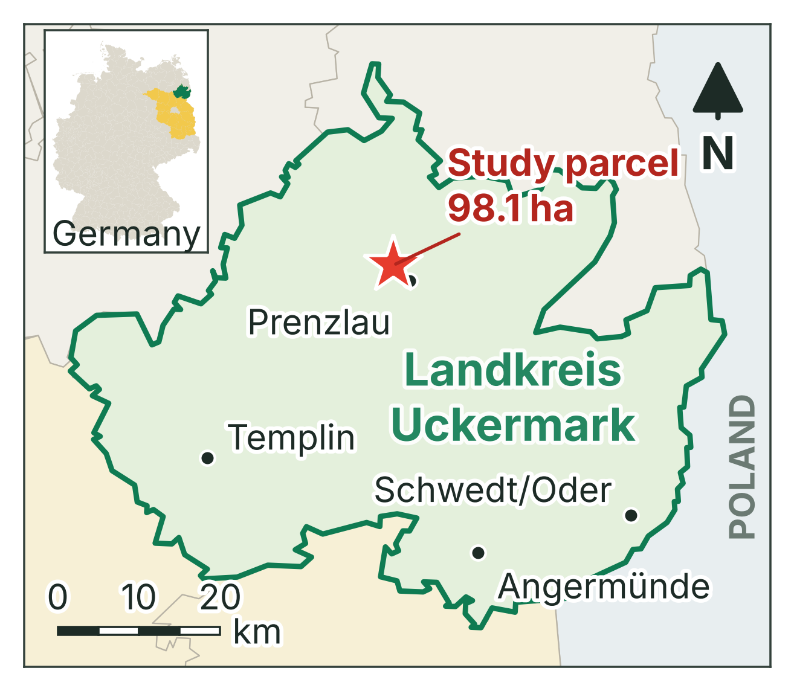
</p>

**Figure 1.** Location of the 98.1 ha study parcel (red star) within Landkreis Uckermark (green outline), Brandenburg (yellow in the inset), Germany. Main towns are shown for orientation; the eastern edge of the district borders Poland along the Oder. Projection ETRS89 / UTM zone 33N (EPSG:25833); 20 km scale bar; district boundaries from GADM.


**Field boundary.** A single boundary definition is used for the whole study and is frozen to `output/field_boundary.geojson` on the first run. The notebook first queries the OpenStreetMap Overpass API for the `landuse=farmland` parcel containing the seed point; because Overpass was unreachable during the reported run, the **digitised fallback polygon** (8 vertices) was used:

| Property | Value |
|---|---|
| Boundary provenance | Digitised fallback polygon (Overpass unavailable) |
| Polygon area | **98.10 ha** |
| Bounding-box area | 125.41 ha (27.8 % larger than the parcel) |
| Vertices | 8 |
| Analysis CRS | WGS 84 / UTM zone 33N (EPSG:32633), 10 m pixels |

### 2.2 Satellite data and NDVI

| Item | Specification |
|---|---|
| Collection | Copernicus Sentinel-2 Level-2A surface reflectance, `COPERNICUS/S2_SR_HARMONIZED` (Google Earth Engine [[3]](#ref3)) |
| Period | 1 June – 15 July 2024 (peak vegetative growth) |
| Scene filter | `CLOUDY_PIXEL_PERCENTAGE` < 40 % → **7 scenes** |
| Cloud masking | QA60 band, opaque-cloud (bit 10) and cirrus (bit 11) flags removed |
| Scaling | Digital numbers ÷ 10,000 → reflectance |
| Index | NDVI from B8 (NIR, 842 nm) and B4 (red, 665 nm) |
| Compositing | Per-pixel **median** of all cloud-free NDVI values |
| Export | Georeferenced GeoTIFF, 10 m, EPSG:32633; cloud gaps encoded as −9999 (not 0) |

The NDVI [[13]](#ref13) is computed per scene as

$$
\mathrm{NDVI} = \frac{\rho_{\mathrm{NIR}} - \rho_{\mathrm{Red}}}{\rho_{\mathrm{NIR}} + \rho_{\mathrm{Red}}} = \frac{B8 - B4}{B8 + B4}.
$$

### 2.3 Polygon clipping and clip audit

An earlier version of the analysis extracted the raster with `geemap.ee_to_numpy()`, which returns the array over the **bounding box** of the region: a 98.1 ha parcel produced a **379.4 ha** array, so pixels from neighbouring parcels, tracks and margins entered the "ground truth". The revised pipeline clips the image to the parcel in Earth Engine, exports a georeferenced GeoTIFF, and then masks it again with `rasterio.mask.mask(..., crop=True)`. An automatic **clip audit** fails loudly if the valid-pixel area disagrees with the polygon by more than 5 %:

| Clip-audit stage | Area (ha) | Raster size |
|---|---:|---|
| Parcel polygon | 98.10 | — |
| Exported raster (bounding box) | 131.52 | 96 × 137 px |
| After crop to polygon bounding box | 126.90 | 94 × 135 px |
| **Valid pixels inside polygon** | **98.11** | **9,811 px** |
| Polygon vs. valid-pixel discrepancy | **0.01 %** → PASS | |

Bounding-box extraction would have included 33.4 ha (34 %) of pixels outside the parcel.

### 2.4 Reference NDVI surface

<p align="center">
  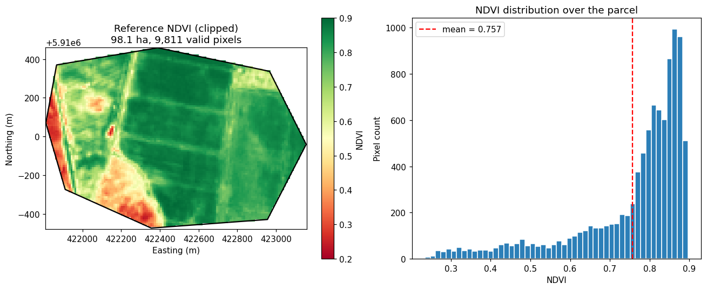
</p>

**Figure 3.** *Left:* reference NDVI over the clipped 98.1 ha parcel (9,811 valid pixels; RdYlGn colour scale 0.2–0.9; local UTM coordinates). *Right:* distribution of NDVI values, mean 0.757 (dashed line). The surface combines a dominant high-vigor body (NDVI > 0.8) with low-vigor patches along the south-western and western margins and narrow linear within-field structures; the distribution is strongly left-skewed.

| Statistic | Value |
|---|---|
| Mean NDVI | 0.757 |
| Standard deviation | 0.144 |
| Range | 0.235 – 0.896 |
| Valid pixels | 9,811 (10 m) |

---

## 3. Methodology

### 3.1 Workflow overview

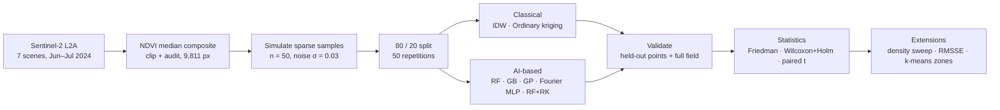

### 3.2 Sparse-sampling simulation

Because the reference NDVI is known at every pixel, sparse field campaigns can be simulated and every reconstruction scored against the truth. For each realisation, `n` pixel locations are drawn **without replacement from the valid in-parcel pixels only**, and Gaussian sensor noise is added:

$$
z_{\mathrm{meas}}(\mathbf{s}_i) = z_{\mathrm{true}}(\mathbf{s}_i) + \varepsilon_i, \qquad \varepsilon_i \sim \mathcal{N}(0,\, 0.03^2).
$$

Coordinates are handled in local metres (origin at the raster's upper-left corner; an exact rigid shift of UTM 33N), which keeps the kriging system numerically well conditioned. Every realisation is seed-controlled (master seed 42).

### 3.3 Classical interpolators

**Inverse distance weighting (IDW)** [[4]](#ref4) predicts an unsampled location $\mathbf{s}_0$ from its $k$ nearest samples:

$$
\hat z(\mathbf{s}_0) = \frac{\sum_{i=1}^{k} w_i\, z_i}{\sum_{i=1}^{k} w_i}, \qquad w_i = d(\mathbf{s}_0, \mathbf{s}_i)^{-p}.
$$

The power $p \in \{1, 2, 3\}$ and neighbourhood size $k \in \{4, 6, 8, 12\}$ are selected **inside every run by leave-one-out cross-validation (LOOCV) on the training points only** (KD-tree implementation).

**Ordinary kriging (OK)** [[5]](#ref5), [[6]](#ref6) is the best linear unbiased predictor under an unknown constant mean:

$$
\hat z(\mathbf{s}_0) = \sum_{i=1}^{n} \lambda_i z_i, \qquad \sum_{i=1}^{n} \lambda_i = 1,
$$

with weights obtained from a fitted semivariogram $\gamma(h)$. Kriging also returns a **prediction variance** $\sigma^2_{\mathrm{OK}}(\mathbf{s}_0)$ at every pixel. Four variogram models (spherical, exponential, Gaussian, linear) were compared over 10 independent realisations (n = 50) by kriging LOOCV RMSE and variogram-fit SSE; the model with the lowest mean LOOCV RMSE was selected programmatically and used everywhere downstream. The selected **exponential** model (PyKrige parameterisation, practical range $a$) is

$$
\gamma(h) = c_0 + c\left[1 - \exp\!\left(-\frac{3h}{a}\right)\right].
$$

### 3.4 Learning-based (AI) predictors

All methods share one interface, `fit(x, y, z) → predict(xq, yq) → (prediction, SD or None)`, so every method is trained and scored on **exactly the same points** in every run.

**Spatial feature block (tree-based learners).** A tree ensemble given only coordinates produces blocky, axis-aligned surfaces with no notion of distance decay. Following Hengl et al. [[11]](#ref11), each location is therefore described by **20 features**: its coordinates $(x, y)$; the distances $d_1 \dots d_8$ to its $K = 8$ nearest training samples; their values $z_1 \dots z_8$; an inverse-distance estimate; and the local mean of those neighbours. **Leakage control:** when features are built for the training points themselves, each point is excluded from its own neighbour set (`exclude_self=True`).

| Method | Family | Inputs | Configuration |
|---|---|---|---|
| **IDW (LOOCV-tuned)** | Deterministic | Sample coordinates and values | $p \in \{1,2,3\}$, $k \in \{4,6,8,12\}$ by LOOCV |
| **Ordinary kriging (OK)** | Geostatistical | Sample coordinates and values | Exponential variogram (selected by LOOCV); returns prediction variance |
| **Random forest (RF)** [[7]](#ref7) | Machine learning | 20 spatial features | 300 trees, `min_samples_leaf = 1` |
| **Gradient boosting (GB)** [[8]](#ref8) | Machine learning | 20 spatial features | Histogram GB, 300 iterations, learning rate 0.08, `min_samples_leaf = 3` |
| **Gaussian process (GP)** [[9]](#ref9) | Machine learning (probabilistic) | Standardised coordinates | Constant × Matérn (ν = 1.5) + white-noise kernel; hyperparameters by marginal likelihood (2 optimiser restarts); returns predictive SD |
| **Fourier-feature MLP** [[10]](#ref10) | Deep learning | Random Fourier encoding of coordinates (48 frequencies, sin + cos) | Bandwidth σ ∈ {0.5, 1.5, 4.0} chosen by 5-fold CV on training points; MLP 2 × 64 ReLU, Adam, L2 α = 10⁻³, learning rate 5 × 10⁻³ |
| **RF + residual kriging (RF + RK)** | Hybrid | 20 spatial features + residuals | RF trend plus ordinary kriging (exponential variogram) of the RF residuals (regression kriging) |

The Gaussian process is the machine-learning formulation of kriging: its covariance is learned by marginal-likelihood optimisation instead of being fitted to an experimental variogram. The Fourier-feature MLP is a coordinate-based implicit neural representation; the random positional encoding counters the spectral bias that makes plain MLPs blur spatial detail.

### 3.5 Validation protocol

Each of **50 repetitions**:

1. draws a **fresh** sparse realisation (sample locations *and* split both vary);
2. splits it **80 / 20** into 40 training and 10 held-out points;
3. fits **every** method on the same training points, with all hyperparameter selection done inside the run on training data only;
4. scores each method on the **held-out points**, then refits on all 50 samples and scores the **full field** (all 9,811 valid pixels).

Accuracy metrics (with $\bar z$ the mean of the reference values):

$$
\mathrm{RMSE} = \sqrt{\frac{1}{N}\sum_{j=1}^{N}\left(\hat z_j - z_j\right)^2}, \qquad
\mathrm{MAE} = \frac{1}{N}\sum_{j=1}^{N}\left|\hat z_j - z_j\right|, \qquad
R^2 = 1 - \frac{\sum_j (z_j - \hat z_j)^2}{\sum_j (z_j - \bar z)^2}.
$$

Because all methods see identical data in each run, the runs are **paired** and support repeated-measures testing.

### 3.6 Statistical testing

Comparing seven predictors with all pairwise *t*-tests would inflate false positives. The protocol of Demšar [[12]](#ref12) is used instead (α = 0.05):

1. **Friedman test** [[14]](#ref14) on held-out RMSE across the 50 paired runs: does *any* method differ?
2. **Mean rank** of each method (1 = lowest RMSE in a run).
3. **Post-hoc Wilcoxon signed-rank tests** [[15]](#ref15) of every method against the best-ranked one, with **Holm** correction [[16]](#ref16).
4. The specific pairwise claim **IDW vs. ordinary kriging** is additionally tested with a paired *t*-test, its 95 % confidence interval and Cohen's *d* effect size.

### 3.7 Sampling-density sweep

To locate a possible crossover between classical and learned predictors, the whole comparison was repeated for **n = 20, 50, 100 and 200 samples** (0.20, 0.51, 1.02 and 2.04 samples ha⁻¹), with **30 repetitions** per density and method, scored by full-field RMSE.

### 3.8 Uncertainty calibration

For the two methods that return a predictive standard deviation $\hat\sigma$ (OK and GP), calibration is assessed on the held-out points with the root-mean-square standardised error:

$$
\mathrm{RMSSE} = \sqrt{\frac{1}{N}\sum_{j=1}^{N}\left(\frac{z_j - \hat z_j}{\hat\sigma_j}\right)^2}.
$$

RMSSE ≈ 1 indicates a well-calibrated variance; < 1 a conservative (over-stated) and > 1 an optimistic (under-stated) uncertainty.

### 3.9 Management zones

The surface with the best **mean full-field RMSE across repetitions** (ordinary kriging, not a single-run pick) is partitioned into **three vigor zones** with k-means clustering [[17]](#ref17) on the NDVI values (k = 3, 10 initialisations, clusters ordered by centroid). The same procedure is applied to the reference raster and to every method's reconstruction; **zone agreement** is the share of the 9,811 pixels assigned to the same zone as in the reference-raster zoning.

### 3.10 Implementation

Python on Google Colab with Earth Engine / `geemap` [[19]](#ref19) for data access, `rasterio` and `geopandas` for geoprocessing, `PyKrige` [[21]](#ref21) for kriging, `scikit-learn` [[18]](#ref18) for the learning-based predictors and k-means, and `SciPy` for statistics. All rasters are exported in UTM 33N with the true affine transform.

---

## 4. Results

### 4.1 Variogram model selection

| Variogram model | LOOCV RMSE (mean) | LOOCV RMSE (SD) | Fit SSE (mean) | Successful fits |
|---|---:|---:|---:|---:|
| **Exponential** ✅ | **0.10392** | 0.01171 | 0.00059 | 10 / 10 |
| Spherical | 0.10632 | 0.01259 | 0.00043 | 10 / 10 |
| Linear | 0.11113 | 0.01292 | 0.00024 | 10 / 10 |
| Gaussian | 0.74942 | 1.98787 | 0.00034 | 10 / 10 |

**Selected:** exponential, partial sill 0.0348, practical range **1,129 m**, nugget 0.0013. Samples more than ~1.1 km apart are effectively uncorrelated, which bounds a useful sampling-grid spacing on this field. Note that the variogram with the best fit to the experimental semivariogram (linear, lowest SSE) is not the best predictor; the Gaussian model is numerically unstable at this sample size (very large LOOCV SD).

<p align="center">
  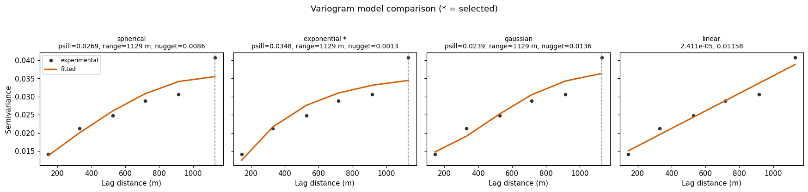
</p>

**Figure 4.** Experimental (dots) and fitted (lines) semivariograms for the spherical, exponential (selected, ★), Gaussian and linear models on one realisation (n = 50); semivariance against lag distance (m), with fitted partial sill, range and nugget in each panel title.

### 4.2 Accuracy of the seven predictors (n = 50, 50 repetitions)

**Held-out points** (10 points per run; mean ± SD over 50 runs):

| Rank | Method | Family | RMSE | MAE | R² |
|---:|---|---|---|---|---|
| 1 | **Ordinary kriging** | Geostatistical | **0.0891 ± 0.0352** | 0.0635 ± 0.0212 | **0.318 ± 0.440** |
| 2 | **IDW (LOOCV-tuned)** | Deterministic | 0.0905 ± 0.0347 | **0.0629 ± 0.0218** | 0.281 ± 0.507 |
| 3 | RF + residual kriging | Hybrid | 0.0958 ± 0.0379 | 0.0668 ± 0.0243 | 0.146 ± 0.695 |
| 4 | Gaussian process (Matérn) | Machine learning | 0.0968 ± 0.0411 | 0.0691 ± 0.0258 | 0.203 ± 0.567 |
| 5 | Random forest | Machine learning | 0.0976 ± 0.0372 | 0.0695 ± 0.0245 | 0.100 ± 0.845 |
| 6 | Fourier-feature MLP | Deep learning | 0.1030 ± 0.0429 | 0.0752 ± 0.0313 | −0.039 ± 1.069 |
| 7 | Gradient boosting | Machine learning | 0.1098 ± 0.0463 | 0.0778 ± 0.0321 | −0.219 ± 1.598 |

**Full field** (all 9,811 valid pixels per run; mean ± SD over 50 runs):

| Rank | Method | Family | RMSE | MAE | R² |
|---:|---|---|---|---|---|
| 1 | **Ordinary kriging** | Geostatistical | **0.0917 ± 0.0114** | **0.0595 ± 0.0053** | **0.586 ± 0.104** |
| 2 | **IDW (LOOCV-tuned)** | Deterministic | 0.0944 ± 0.0101 | 0.0607 ± 0.0053 | 0.562 ± 0.092 |
| 3 | RF + residual kriging | Hybrid | 0.0977 ± 0.0106 | 0.0636 ± 0.0062 | 0.532 ± 0.099 |
| 4 | Gaussian process (Matérn) | Machine learning | 0.0984 ± 0.0100 | 0.0639 ± 0.0058 | 0.525 ± 0.095 |
| 5 | Fourier-feature MLP | Deep learning | 0.1003 ± 0.0189 | 0.0680 ± 0.0141 | 0.494 ± 0.212 |
| 6 | Random forest | Machine learning | 0.1011 ± 0.0100 | 0.0667 ± 0.0057 | 0.499 ± 0.098 |
| 7 | Gradient boosting | Machine learning | 0.1122 ± 0.0135 | 0.0740 ± 0.0088 | 0.380 ± 0.153 |

Ordinary kriging has the lowest mean RMSE under both validation schemes. The full-field RMSE values have SDs roughly two to four times smaller than the held-out values, because they average over ~10⁴ pixels instead of 10 points.

<p align="center">
  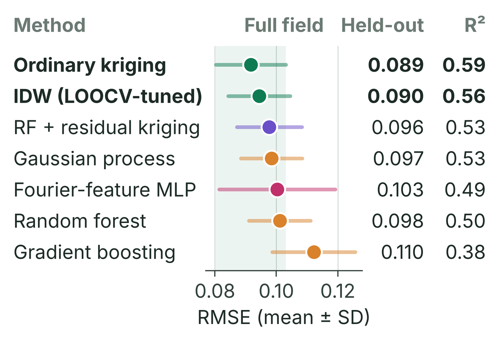
</p>

**Figure 5.** Accuracy ranking of the seven predictors (poster version). Dots and whiskers: full-field RMSE mean ± SD over 50 paired runs; right-hand columns: mean held-out RMSE and mean full-field R². Colours encode method family: green = classical, purple = hybrid, orange = machine learning, magenta = deep learning. The shaded band marks ordinary kriging's ±1 SD range.

<p align="center">
  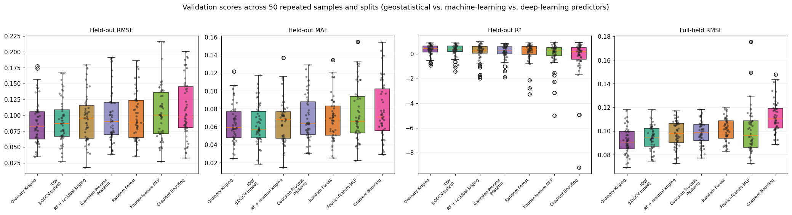
</p>

**Figure 6.** Distribution of validation scores across the 50 repeated samples and splits for each method: held-out RMSE, held-out MAE, held-out R² and full-field RMSE (box plots with individual runs). The wide held-out spread, including strongly negative R² values for some runs, shows why a single split is unreliable.

### 4.3 Statistical significance

**Friedman test** (held-out RMSE, 7 methods, 50 runs): **χ² = 35.55, df = 6, p = 3.38 × 10⁻⁶**, so at least one method differs and post-hoc tests are licensed.

| Mean rank (1 = best) | Method |
|---:|---|
| **3.00** | IDW (LOOCV-tuned) |
| **3.04** | Ordinary kriging |
| 3.90 | RF + residual kriging |
| 4.16 | Gaussian process (Matérn) |
| 4.32 | Random forest |
| 4.72 | Fourier-feature MLP |
| 4.86 | Gradient boosting |

**Post-hoc Wilcoxon signed-rank tests against the best-ranked method (IDW), Holm-corrected:**

| Comparison | Δ mean RMSE | IDW wins | p (Wilcoxon) | p (Holm-adj.) | Significant |
|---|---:|---:|---:|---:|:---:|
| IDW vs. ordinary kriging | −0.0014 | 50 % | 0.7741 | 0.7741 | no |
| IDW vs. random forest | +0.0071 | 70 % | 0.0028 | 0.0112 | **yes** |
| IDW vs. gradient boosting | +0.0192 | 76 % | < 0.0001 | 0.0002 | **yes** |
| IDW vs. Gaussian process | +0.0063 | 68 % | 0.0083 | 0.0208 | **yes** |
| IDW vs. Fourier-feature MLP | +0.0125 | 68 % | 0.0014 | 0.0072 | **yes** |
| IDW vs. RF + residual kriging | +0.0053 | 68 % | 0.0069 | 0.0208 | **yes** |

IDW is significantly better than all five learning-based predictors after correction, and indistinguishable from ordinary kriging.

**IDW vs. ordinary kriging (the pairwise claim of the original abstract):**

| IDW mean RMSE | OK mean RMSE | Mean difference | 95 % CI | p (paired *t*) | p (Wilcoxon) | Cohen's *d* |
|---:|---:|---:|---|---:|---:|---:|
| 0.0905 | 0.0891 | +0.0014 | [−0.0018, +0.0045] | 0.379 | 0.774 | 0.125 |

> **Verdict.** IDW and ordinary kriging are statistically indistinguishable on held-out RMSE; the mean difference of 0.0014 NDVI units lies within run-to-run noise. The RMSE gap of 0.066 vs. 0.078 reported in the originally submitted abstract was an artefact of a single train/test split.

**Why a single split is unsafe.** Held-out R² ranged widely across the 50 repetitions for every method, and kriging beat IDW in exactly 50 % of runs:

| Method | Held-out R² range across 50 runs | SD |
|---|---|---:|
| IDW (LOOCV-tuned) | −1.44 to 0.89 | 0.51 |
| Ordinary kriging | −0.93 to 0.89 | 0.44 |
| Random forest | −3.27 to 0.88 | 0.85 |
| Gradient boosting | −9.20 to 0.90 | 1.60 |
| Gaussian process (Matérn) | −1.90 to 0.85 | 0.57 |
| Fourier-feature MLP | −4.99 to 0.93 | 1.07 |
| RF + residual kriging | −1.97 to 0.97 | 0.70 |

A single-split smoke test on the reference realisation even ranked the **Fourier-feature MLP first** (RMSE 0.0487, R² 0.887) and ordinary kriging fifth, which is the opposite of the 50-run result. This illustrates how one draw can invert a comparison.

### 4.4 Does AI add anything? Method families compared

| Family | Best method | Held-out RMSE | Held-out R² | Full-field RMSE | vs. best geostatistics (held-out) |
|---|---|---:|---:|---:|---:|
| Geostatistical | Ordinary kriging | **0.0891** | 0.318 | **0.0917** | — |
| Deterministic | IDW (LOOCV-tuned) | 0.0905 | 0.281 | 0.0944 | +1.6 % |
| Hybrid | RF + residual kriging | 0.0958 | 0.146 | 0.0977 | +7.5 % |
| Machine learning | Gaussian process (Matérn) | 0.0968 | 0.203 | 0.0984 | +8.6 % |
| Deep learning | Fourier-feature MLP | 0.1030 | −0.039 | 0.1003 | +15.5 % |

At n = 50 (40 training points per run), the neural predictor is ~16 % worse than the best geostatistical method. Forty numbers are far below the regime in which a coordinate network can learn a two-dimensional field; this is a **data-regime limit, not an architectural failure**.

### 4.5 Effect of sampling density

Full-field RMSE (mean of 30 repetitions per density):

| n (samples ha⁻¹) | OK | IDW | GP | RF + RK | RF | MLP | GB | Best ML/DL vs. best geostatistics |
|---|---:|---:|---:|---:|---:|---:|---:|---:|
| 20 (0.20) | **0.1124** | 0.1139 | 0.1206 | 0.1176 | 0.1221 | 0.1307 | 0.1367 | **+7.3 %** |
| 50 (0.51) | **0.0898** | 0.0928 | 0.0967 | 0.0982 | 0.1022 | 0.0968 | 0.1140 | **+7.7 %** |
| 100 (1.02) | **0.0724** | 0.0786 | 0.0795 | 0.0804 | 0.0840 | 0.0798 | 0.0950 | **+9.8 %** |
| 200 (2.04) | **0.0605** | 0.0651 | 0.0644 | 0.0666 | 0.0681 | 0.0726 | 0.0746 | **+6.4 %** |

"Best ML/DL" is the lowest-RMSE machine-learning or deep-learning method at each density (the Gaussian process in all four cases; the hybrid is reported separately). **No learned predictor overtakes geostatistics anywhere in the tested range**; if a crossover exists, it lies above 200 samples (2.0 samples ha⁻¹). Ordinary kriging is the best method at every density, and its advantage over IDW grows with sample size (from 1.3 % at n = 20 to 7.6 % at n = 200).

<p align="center">
  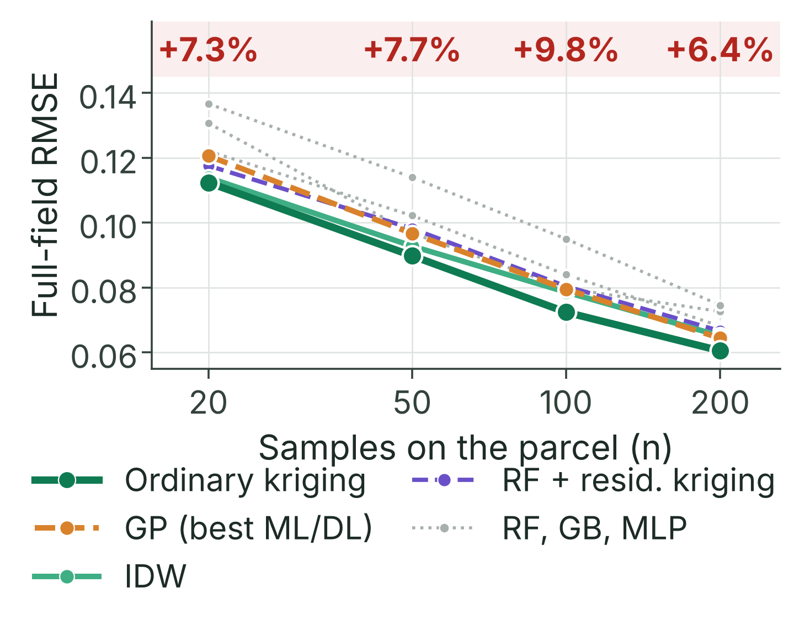
</p>

**Figure 7.** Full-field RMSE versus number of samples on the parcel (log scale; poster version). Solid lines = classical methods (ordinary kriging, IDW); dashed = learned methods (Gaussian process as best ML/DL, RF + residual kriging); dotted grey = RF, gradient boosting and MLP. The red band gives the RMSE penalty of the best ML/DL predictor relative to the best geostatistical method at each density.

<p align="center">
  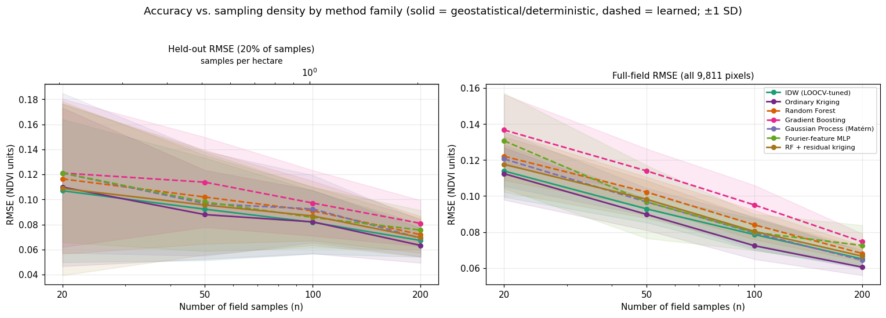
</p>

**Figure 8.** Notebook version of the density sweep: *left*, held-out RMSE (20 % of samples) with a secondary axis in samples per hectare; *right*, full-field RMSE (all 9,811 pixels). Solid = geostatistical/deterministic, dashed = learned; shaded bands = ±1 SD over 30 repetitions.

### 4.6 Reference reconstruction (single realisation)

To produce the map products, every method was fitted once to the fixed reference realisation (n = 50, seed 42, all samples used). These single-run metrics complement, and must be read alongside, the 50-run distributions above.

| Method | Family | RMSE | MAE | R² |
|---|---|---:|---:|---:|
| **Ordinary kriging** | Geostatistical | **0.0692** | **0.0460** | **0.768** |
| RF + residual kriging | Hybrid | 0.0726 | 0.0480 | 0.744 |
| IDW (LOOCV-tuned) | Deterministic | 0.0744 | 0.0503 | 0.731 |
| Gaussian process (Matérn) | Machine learning | 0.0771 | 0.0513 | 0.712 |
| Fourier-feature MLP | Deep learning | 0.0777 | 0.0524 | 0.707 |
| Random forest | Machine learning | 0.0831 | 0.0580 | 0.665 |
| Gradient boosting | Machine learning | 0.0925 | 0.0636 | 0.584 |

IDW hyperparameters selected by LOOCV for this realisation: power p = 1, k = 4 neighbours (LOOCV RMSE 0.1045).

<p align="center">
  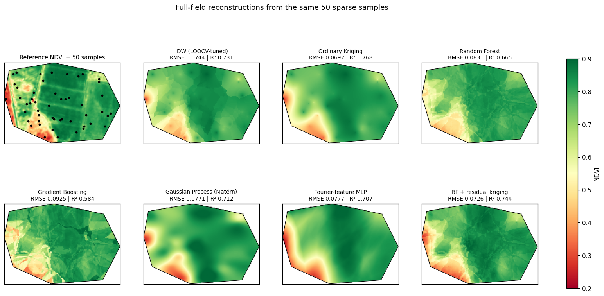
</p>

**Figure 9.** Full-field reconstructions from the same 50 sparse samples. Top-left: reference NDVI with the sample locations (black dots); remaining panels: IDW, ordinary kriging, random forest, gradient boosting, Gaussian process, Fourier-feature MLP and RF + residual kriging, each titled with its full-field RMSE and R². Kriging and the Gaussian process yield smooth fields that preserve the main low-vigor patches; IDW shows "bull's-eye" artefacts around samples; random forest and gradient boosting produce blocky, fragmented patterns even with the spatial feature block.

<p align="center">
  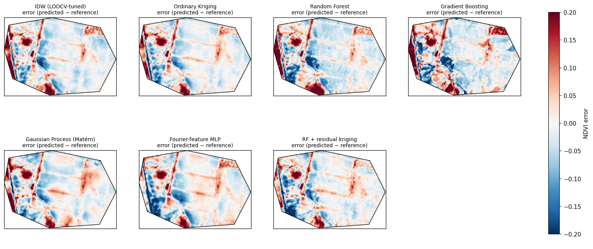
</p>

**Figure 10.** Per-pixel error maps (predicted − reference NDVI; diverging scale −0.2 to +0.2) for the seven methods. All methods share large errors along the low-vigor western and south-western margins and along linear tramline structures, which sparse samples cannot resolve; tree ensembles add patchy errors across the field interior.

### 4.7 Uncertainty calibration

| Method | RMSSE (mean) | RMSSE (SD) | Standardised bias |
|---|---:|---:|---:|
| **Ordinary kriging** | **0.881** | 0.339 | 0.017 |
| Gaussian process (Matérn) | 1.115 | 0.473 | 0.010 |

Kriging's RMSSE is close to 1, so its predictive variance is well calibrated against the observed held-out errors and can serve as a per-pixel uncertainty layer. It is slightly conservative, while the Gaussian process is slightly optimistic and more variable across runs.

<p align="center">
  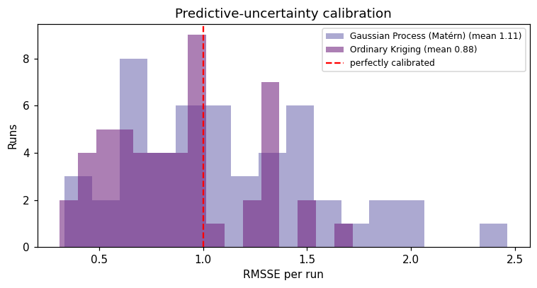
</p>

**Figure 11.** Distribution of per-run RMSSE over the 50 repetitions for the Gaussian process (mean 1.11) and ordinary kriging (mean 0.88); the dashed red line marks perfect calibration (RMSSE = 1).

<p align="center">
  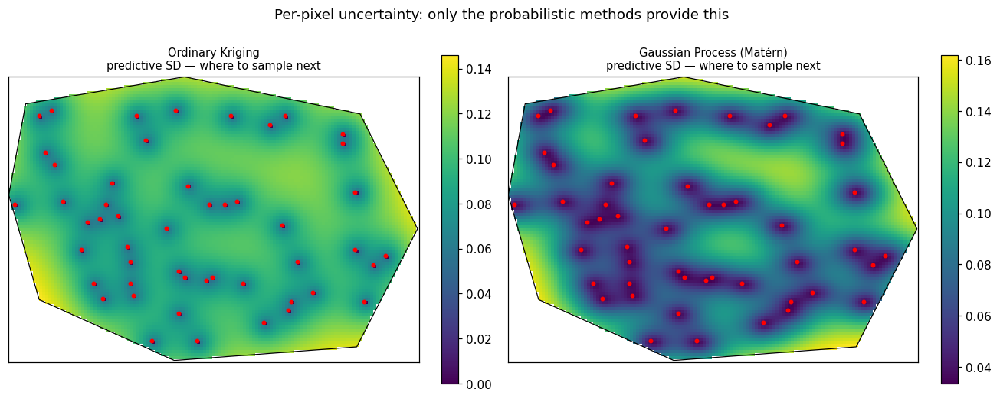
</p>

**Figure 12.** Per-pixel predictive standard deviation of ordinary kriging (*left*) and the Gaussian process (*right*) with the 50 sample locations. Uncertainty is lowest at samples and highest in poorly sampled areas and along the parcel edges, which directly indicates **where to sample next** in an adaptive campaign. Only the probabilistic methods provide this layer.

### 4.8 Management zones

Zones derived from the ordinary-kriging surface (k-means, k = 3):

| Zone | Pixels | Area (ha) | Share (%) | Mean NDVI |
|---|---:|---:|---:|---:|
| 🟥 Low vigor | 1,320 | 13.20 | 13.5 | 0.494 |
| 🟨 Medium vigor | 2,500 | 25.00 | 25.5 | 0.718 |
| 🟩 High vigor | 5,991 | 59.91 | 61.1 | 0.830 |

Pixel-wise agreement with zones derived from the reference raster:

| Method | Zone agreement (%) |
|---|---:|
| Gaussian process (Matérn) | 82.0 |
| Random forest | 81.9 |
| **Ordinary kriging** | **81.4** |
| RF + residual kriging | 79.6 |
| Fourier-feature MLP | 78.3 |
| IDW (LOOCV-tuned) | 72.3 |
| Gradient boosting | 71.6 |

<p align="center">
  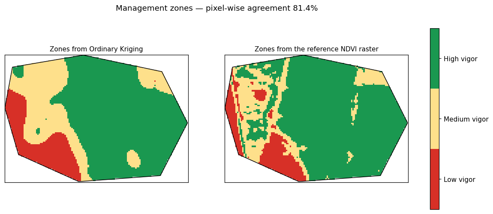
</p>

**Figure 13.** Three-class management zones (red = low, yellow = medium, green = high vigor) from the ordinary-kriging reconstruction (*left*) and from the reference NDVI raster (*right*); pixel-wise agreement 81.4 %. The kriging zones capture the large low-vigor areas in the south-west and west but smooth out narrow linear features visible in the reference zoning.

Zone agreement is less discriminating than RMSE: three methods (GP, RF, OK) reproduce ~81–82 % of the reference zoning, because a three-class partition is tolerant of moderate errors within each class. IDW's bull's-eye artefacts cost it ~9 percentage points.

---

## 5. Discussion

### 5.1 Geostatistics remains the reliable default under sparse sampling

Across 50 paired repetitions, two validation schemes and four sampling densities, ordinary kriging and IDW consistently delivered the most accurate NDVI reconstructions. The ranking is robust: kriging had the lowest mean RMSE at every density, and IDW was significantly better than every learning-based predictor. Geostatistics works well here because its inductive bias, smooth spatial dependence parameterised by only three variogram parameters, matches what 20–200 points can support.

### 5.2 Why the learners fall short in this regime

The learners were evaluated where they are weakest. With 40 training points per run:

- **Tree ensembles** (RF, GB) partition feature space into axis-aligned regions and produce blocky surfaces, even with neighbour-based spatial features.
- **The Gaussian process** comes closest to geostatistics (it is kriging with a learned kernel), but estimating kernel hyperparameters by marginal likelihood from 40 points is less stable than fitting a variogram.
- **The Fourier-feature MLP** has far more parameters than observations; its single-split "win" in the smoke test vanished under repeated validation.
- **The hybrid** (RF + residual kriging) is the best AI-based option, because the kriging step restores spatial dependence that the forest misses.

### 5.3 The danger of single-split evaluation

The original submission reported an IDW vs. kriging gap (RMSE 0.066 vs. 0.078) from one split of 10 held-out points. With 50 repetitions, the same comparison is a coin flip (kriging wins 50 % of runs, p = 0.38), and held-out R² for a single method ranges from strongly negative to ~0.9. Full-field scoring over 9,811 pixels reduces the SD of RMSE roughly two- to four-fold. **Repeated, paired evaluation with full-field scoring should be the minimum standard for interpolation benchmarks on simulated sparse samples.**

### 5.4 Practical value of calibrated uncertainty

Beyond accuracy, kriging provides a calibrated (RMSSE 0.88) per-pixel uncertainty map. In practice this is as valuable as the prediction itself: it shows a field manager where additional samples would reduce uncertainty most, enabling **adaptive, uncertainty-guided sampling**.

### 5.5 Limitations

1. **The samples are simulated, not measured.** Points are drawn from the Sentinel-2 raster with additive Gaussian noise, so they inherit the satellite's own spatial structure. Real soil probes or yield-monitor readings measure a different quantity with different, spatially correlated error; accuracy on real ground data will likely be lower.
2. **The learners are evaluated in their weakest regime.** Forty training points are far below where neural networks are competitive. A fair reading is "geostatistics is the right default at field-sampling densities", not "learning-based methods do not work for this problem". The scope is one field at 0.2–2 samples ha⁻¹.
3. **No transfer learning across fields was attempted.** This is where deep learning would plausibly win: a network pre-trained on many fields brings prior structure that kriging cannot.
4. **One field, one season.** Transferability across crops and phenological stages is untested.
5. **The reference is itself a product**, not truth: a cloud-masked median composite carries atmospheric-correction and compositing error.
6. **Ordinary kriging assumes second-order stationarity** over the parcel, which is only approximately true where management history creates sharp internal boundaries.
7. **Management zones have no agronomic validation** against yield or soil data, so the variable-rate step remains a proof of concept.

---

## 6. Conclusions

- At sampling densities typical of field campaigns (**0.2–2 samples ha⁻¹**), **ordinary kriging and IDW are the most reliable NDVI reconstructors** and are statistically equivalent (p = 0.38).
- **No AI predictor surpassed geostatistics at any tested density**; the best ML/DL predictor remained 6.4–9.8 % worse. This is a **data-regime limit**, not an architectural failure.
- Kriging additionally delivers **calibrated per-pixel uncertainty** (RMSSE 0.88) for adaptive sampling, and supports **management-zone delineation** with 81.4 % agreement with reference zones.
- For AI in remote sensing, the benchmark **marks the data threshold** below which learned predictors should not replace geostatistics.

**Outlook.** Multi-parcel, multi-season validation with real ground measurements; transfer learning with networks pre-trained on many fields; and higher sampling densities to locate the crossover point.

---

## 7. Conference Poster

The study is presented as a poster at **ECRS-6, Session S1 – AI in Remote Sensing**.

| Specification | Value |
|---|---|
| Format | A0 portrait, 84.1 × 118.9 cm |
| Resolution | 300 dpi, 9,933 × 14,043 px |
| Minimum font size | ≥ 24 pt (verified for all text) |
| File | [`poster/ECRS6_poster_A0.pdf`](poster/ECRS6_poster_A0.pdf) |

The poster's charts (Figures 1, 5 and 7 in this README) were redrawn at print size from the notebook results. A QR code on the poster links to this repository:

<p align="center">
  
</p>

---

## 8. Repository Structure

```text
Sparse-Sample-Reconstruction-of-Crop-Vigor-Using-Sentinel-2-NDVI/
├── README.md                                       ← this document
├── precision_ag_spatial_interpolation_REVISED.ipynb  ← complete analysis (§0–§10)
├── requirements.txt                                ← Python dependencies
├── figures/
│   ├── notebook/                                   ← figures produced by the notebook
│   │   ├── Fig1_study_area.png
│   │   ├── Fig2_reference_ndvi.png
│   │   ├── Fig3_variogram_models.png
│   │   ├── Fig4_method_distributions.png
│   │   ├── Fig5_uncertainty_calibration.png
│   │   ├── Fig6_density_sweep.png
│   │   ├── Fig7_reconstructions.png
│   │   ├── Fig7b_error_maps.png
│   │   ├── Fig7c_uncertainty_surfaces.png
│   │   └── Fig8_management_zones.png
│   └── poster/                                     ← print-quality poster graphics
│       ├── poster_preview.png
│       ├── poster_study_area_uckermark.png
│       ├── poster_accuracy_ranking.png
│       ├── poster_density_sweep.png
│       └── qr_repository.png
├── poster/
│   └── ECRS6_poster_A0.pdf                         ← conference poster (A0, 300 dpi)
└── output/                                         ← created when the notebook runs
```

---

## 9. Reproducing the Study

### 9.1 Environment

The analysis was developed and run on **Google Colab (Python 3.12)**. Install the dependencies with:

```bash
pip install -r requirements.txt
# or, inside Colab (first notebook cell):
pip install geemap pykrige rasterio geopandas matplotlib-scalebar folium --quiet
```

### 9.2 Data access

Two options:

- **With Google Earth Engine.** Authenticate in §0 and replace the project ID in `ee.Initialize(project='...')` with your own Earth Engine Cloud project. The notebook then builds the Sentinel-2 composite and exports `output/ndvi_reference_utm_raw.tif`.
- **Without Earth Engine (fully reproducible).** If `output/ndvi_reference_utm_raw.tif` already exists, the notebook sets `USE_CACHED_RASTER = True` and runs entirely offline from the cached GeoTIFF.

The field boundary is frozen to `output/field_boundary.geojson` on the first run. To analyse your own parcel, place its polygon at that path before running; delete the file to re-derive it.

### 9.3 Running

Run the notebook top to bottom. On Colab, the repeated-split comparison (§5: 50 × 7 = 350 fits) took **~6 min** and the density sweep (§6) **~18 min**; the remaining sections take a few minutes. For a quick smoke test, reduce `N_REPEATS` and `DENSITY_REPEATS` in §0.

| Notebook section | Content |
|---|---|
| §0 | Configuration, imports, Earth Engine authentication |
| §1 | Field boundary (frozen single source of truth) and study-area map |
| §2 | Sentinel-2 NDVI composite, polygon clipping and clip audit |
| §3 | Sampling frame, IDW and kriging implementations |
| §4 | Variogram model selection; §4b machine-learning and deep-learning predictors |
| §5 | Repeated-split validation; §5b significance testing; §5c method families and uncertainty calibration |
| §6 | Sampling-density sweep |
| §7 | Reference reconstruction, error and uncertainty maps |
| §8 | Management zones |
| §9 | Georeferenced exports and interactive Folium map |
| §10 | Auto-generated results summary for the manuscript |

### 9.4 Configuration

All analysis parameters are set in one cell (§0):

| Parameter | Value | Meaning |
|---|---|---|
| `UTM_CRS` | `EPSG:32633` | Analysis CRS (UTM zone 33N) |
| `PIXEL_SIZE` | 10 m | Sentinel-2 native resolution for B4/B8 |
| `DATE_START`, `DATE_END` | 2024-06-01, 2024-07-15 | Composite window |
| `MAX_CLOUD_PCT` | 40 | Scene-level cloud filter (%) |
| `N_SAMPLES_MAIN` | 50 | Samples per realisation (main experiment) |
| `NOISE_STD` | 0.03 | Simulated sensor noise (NDVI units) |
| `TEST_FRACTION` | 0.2 | Held-out share of samples |
| `N_REPEATS` | 50 | Repeated sample draws and splits |
| `RESAMPLE_POINTS` | True | Redraw sample locations every run |
| `FULL_FIELD_EACH_RUN` | True | Score all valid pixels in every run |
| `DENSITIES` | 20, 50, 100, 200 | Sample sizes in the density sweep |
| `DENSITY_REPEATS` | 30 | Repetitions per density |
| `VARIOGRAM_CANDIDATES` | spherical, exponential, gaussian, linear | Variogram models compared |
| `VARIOGRAM_SEL_REPEATS` | 10 | Realisations for variogram selection |
| `IDW_POWERS`, `IDW_NEIGHBOURS` | (1, 2, 3), (4, 6, 8, 12) | IDW LOOCV grid |
| `K_NEIGHBOURS` | 8 | Neighbours in the spatial feature block |
| `MASTER_SEED` | 42 | Global random seed |
| `N_ZONES` | 3 | Management zones (k-means k) |
| `AREA_TOLERANCE` | 0.05 | Maximum polygon vs. raster area mismatch in the clip audit |

### 9.5 Outputs

All outputs are written to `output/`:

| Type | Files |
|---|---|
| Figures | `Fig1_study_area.png` … `Fig8_management_zones.png` (200 dpi) |
| Tables | `T1_variogram_model_comparison.csv`, `T2_repeated_split_runs.csv`, `T3_heldout_repeated.csv`, `T4_fullfield_repeated.csv`, `T5_posthoc_tests.csv`, `T5b_idw_vs_kriging.csv`, `T5c_family_comparison.csv`, `T5d_uncertainty_calibration.csv`, `T6_density_sweep_runs.csv`, `T7_density_summary.csv`, `T8_reference_fullfield.csv`, `T9_management_zones.csv`, `T9b_zone_agreement_by_method.csv` |
| Rasters (GeoTIFF, UTM 33N) | `ndvi_reference_utm_raw.tif`, `ndvi_reference_utm_clipped.tif`, `background_utm.tif`, `reconstructed_<method>.tif` (7 files), `uncertainty_ordinary_kriging.tif`, `uncertainty_gaussian_process_matern.tif`, `management_zones.tif` |
| Vectors | `field_boundary.geojson`, `field_boundary.gpkg`, `simulated_samples.gpkg`, `simulated_samples.csv` |
| Interactive map | `field_interpolation_map.html` (Folium: reference NDVI, all reconstructions, uncertainty, zones and samples over satellite imagery) |
| Summary | `paper_results_summary.md` (every number reported here) |

---

## 10. Revision History and Response to Reviewers

The submission (Sciforum-208035) was **accepted** after one revision round (decision: 5 Sep 2026). The revised notebook addresses each review point:

| # | Reviewer comment | How it was addressed |
|---|---|---|
| 1 | Validation set too small / single split; results unstable | **§5:** 50 repeated sample draws and splits; mean ± SD for RMSE, MAE and R²; full-field scoring over 9,811 pixels; Friedman, Wilcoxon + Holm, paired *t*-test, 95 % CI and Cohen's *d* |
| 2 | Field boundary must be settled and consistent | **§1:** one frozen boundary file reused by every cell and experiment; area asserted against a declared value |
| 3 | Polygon-clipping bug (98.1 ha polygon vs. 379.4 ha raster) | **§2:** clipped, georeferenced GeoTIFF export plus `rasterio` masking; automatic clip audit (0.01 % discrepancy) |
| 4 | Only one sampling density tested | **§6:** density sweep over n = 20, 50, 100, 200 with 30 repetitions each |
| 5 | Only the spherical variogram was tried | **§4:** four variogram models compared over 10 realisations; exponential selected programmatically |
| — | Relevance to the AI in Remote Sensing session | **§4b, §5c:** five machine-learning and deep-learning predictors added in a fair, leakage-controlled comparison |
| — | Limitations of the validation should be reflected | Limitations stated explicitly ([§5.5](#55-limitations)); results framed as a preliminary single-parcel benchmark |
| — | Avoid first-person pronouns | Impersonal, formal academic style throughout |

Additional changes in the revision: exact georeferencing in UTM 33N via the raster's affine transform; validated (not just displayed) kriging uncertainty; seed control for every experiment; all reported numbers written automatically to `output/paper_results_summary.md`.

---

## 11. How to Cite

If you use this code, data processing chain or results, please cite:

> Alam, M.; Mamun, A.A. Sparse-Sample Reconstruction of Crop Vigor Using Sentinel-2 NDVI: A Preliminary Benchmark of IDW and Kriging for Precision Agriculture. In *Proceedings of the 6th International Electronic Conference on Remote Sensing (ECRS-6)*, Session S1: AI in Remote Sensing; Sciforum-208035, 2026.

```bibtex
@inproceedings{alam2026sparse,
  title     = {Sparse-Sample Reconstruction of Crop Vigor Using Sentinel-2 NDVI:
               A Preliminary Benchmark of IDW and Kriging for Precision Agriculture},
  author    = {Alam, Mahbubul and Mamun, Abdullah All},
  booktitle = {Proceedings of the 6th International Electronic Conference on Remote Sensing (ECRS-6)},
  note      = {Session S1: AI in Remote Sensing. Sciforum-208035},
  year      = {2026}
}
```

*The citation will be updated with the DOI once the proceedings paper is published.*

---

## 12. Acknowledgements and Data Sources

- **Sentinel-2:** contains modified Copernicus Sentinel-2 data (2024), processed in Google Earth Engine.
- **Administrative boundaries:** FAO GAUL 2015 (notebook study-area figure); GADM (poster and README district map).
- **Field boundary:** digitised polygon (OpenStreetMap Overpass query attempted first).
- **Interactive-map basemap:** Esri World Imagery.
- **Software:** PyKrige, scikit-learn, SciPy, NumPy, pandas, rasterio, GeoPandas, Shapely, geemap, Folium, Matplotlib.

---

## 13. License

No license has been specified yet. Until a `LICENSE` file is added, all rights are reserved by the authors; please contact the corresponding author for reuse.

---

## Abbreviations

| Abbreviation | Meaning |
|---|---|
| AI | Artificial intelligence |
| CI | Confidence interval |
| CRS | Coordinate reference system |
| CV | Cross-validation |
| DL | Deep learning |
| ECRS-6 | 6th International Electronic Conference on Remote Sensing |
| ETRS89 | European Terrestrial Reference System 1989 |
| GADM | Database of Global Administrative Areas |
| GAUL | Global Administrative Unit Layers (FAO) |
| GB | Gradient boosting |
| GEE | Google Earth Engine |
| GP | Gaussian process (regression) |
| IDW | Inverse distance weighting |
| *k*, *K* | Number of nearest neighbouring samples (IDW; spatial features); number of clusters (k-means) |
| L2A | Sentinel-2 Level-2A surface reflectance |
| LOOCV | Leave-one-out cross-validation |
| MAE | Mean absolute error |
| ML | Machine learning |
| MLP | Multilayer perceptron (neural network) |
| *n* | Number of samples |
| NDVI | Normalized Difference Vegetation Index |
| NIR | Near infrared |
| OK | Ordinary kriging |
| *p* | *p*-value (significance); IDW power parameter |
| QA60 | Sentinel-2 cloud-mask quality band |
| R² | Coefficient of determination |
| RF | Random forest |
| RF + RK | Random forest + residual kriging (regression kriging) |
| RMSE | Root-mean-square error |
| RMSSE | Root-mean-square standardised error |
| SD | Standard deviation |
| SSE | Sum of squared errors |
| UTM | Universal Transverse Mercator |
| σ | Standard deviation of simulated sensor noise; Fourier-encoding bandwidth |
| χ² | Friedman test statistic |

---

## References

<a id="ref1"></a>[1] Mulla, D.J. Twenty five years of remote sensing in precision agriculture: Key advances and remaining knowledge gaps. *Biosystems Engineering* **2013**, 114, 358–371. https://doi.org/10.1016/j.biosystemseng.2012.08.009

<a id="ref2"></a>[2] Drusch, M.; Del Bello, U.; Carlier, S.; et al. Sentinel-2: ESA's optical high-resolution mission for GMES operational services. *Remote Sensing of Environment* **2012**, 120, 25–36. https://doi.org/10.1016/j.rse.2011.11.026

<a id="ref3"></a>[3] Gorelick, N.; Hancher, M.; Dixon, M.; Ilyushchenko, S.; Thau, D.; Moore, R. Google Earth Engine: Planetary-scale geospatial analysis for everyone. *Remote Sensing of Environment* **2017**, 202, 18–27. https://doi.org/10.1016/j.rse.2017.06.031

<a id="ref4"></a>[4] Shepard, D. A two-dimensional interpolation function for irregularly-spaced data. In *Proceedings of the 1968 23rd ACM National Conference*; ACM: New York, NY, USA, 1968; pp. 517–524. https://doi.org/10.1145/800186.810616

<a id="ref5"></a>[5] Matheron, G. Principles of geostatistics. *Economic Geology* **1963**, 58, 1246–1266. https://doi.org/10.2113/gsecongeo.58.8.1246

<a id="ref6"></a>[6] Oliver, M.A.; Webster, R. A tutorial guide to geostatistics: Computing and modelling variograms and kriging. *Catena* **2014**, 113, 56–69. https://doi.org/10.1016/j.catena.2013.09.006

<a id="ref7"></a>[7] Breiman, L. Random forests. *Machine Learning* **2001**, 45, 5–32. https://doi.org/10.1023/A:1010933404324

<a id="ref8"></a>[8] Friedman, J.H. Greedy function approximation: A gradient boosting machine. *Annals of Statistics* **2001**, 29, 1189–1232. https://doi.org/10.1214/aos/1013203451

<a id="ref9"></a>[9] Rasmussen, C.E.; Williams, C.K.I. *Gaussian Processes for Machine Learning*; MIT Press: Cambridge, MA, USA, 2006.

<a id="ref10"></a>[10] Tancik, M.; Srinivasan, P.P.; Mildenhall, B.; et al. Fourier features let networks learn high frequency functions in low dimensional domains. In *Advances in Neural Information Processing Systems 33 (NeurIPS 2020)*; 2020. https://arxiv.org/abs/2006.10739

<a id="ref11"></a>[11] Hengl, T.; Nussbaum, M.; Wright, M.N.; Heuvelink, G.B.M.; Gräler, B. Random forest as a generic framework for predictive modeling of spatial and spatio-temporal variables. *PeerJ* **2018**, 6, e5518. https://doi.org/10.7717/peerj.5518

<a id="ref12"></a>[12] Demšar, J. Statistical comparisons of classifiers over multiple data sets. *Journal of Machine Learning Research* **2006**, 7, 1–30.

<a id="ref13"></a>[13] Rouse, J.W.; Haas, R.H.; Schell, J.A.; Deering, D.W. Monitoring vegetation systems in the Great Plains with ERTS. In *Third Earth Resources Technology Satellite-1 Symposium*; NASA SP-351; NASA: Washington, DC, USA, 1974; pp. 309–317.

<a id="ref14"></a>[14] Friedman, M. The use of ranks to avoid the assumption of normality implicit in the analysis of variance. *Journal of the American Statistical Association* **1937**, 32, 675–701. https://doi.org/10.1080/01621459.1937.10503522

<a id="ref15"></a>[15] Wilcoxon, F. Individual comparisons by ranking methods. *Biometrics Bulletin* **1945**, 1, 80–83. https://doi.org/10.2307/3001968

<a id="ref16"></a>[16] Holm, S. A simple sequentially rejective multiple test procedure. *Scandinavian Journal of Statistics* **1979**, 6, 65–70.

<a id="ref17"></a>[17] Lloyd, S. Least squares quantization in PCM. *IEEE Transactions on Information Theory* **1982**, 28, 129–137. https://doi.org/10.1109/TIT.1982.1056489

<a id="ref18"></a>[18] Pedregosa, F.; Varoquaux, G.; Gramfort, A.; et al. Scikit-learn: Machine learning in Python. *Journal of Machine Learning Research* **2011**, 12, 2825–2830.

<a id="ref19"></a>[19] Wu, Q. geemap: A Python package for interactive mapping with Google Earth Engine. *Journal of Open Source Software* **2020**, 5, 2305. https://doi.org/10.21105/joss.02305

<a id="ref20"></a>[20] Li, J.; Heap, A.D. A review of comparative studies of spatial interpolation methods in environmental sciences: Performance and impact factors. *Ecological Informatics* **2011**, 6, 228–241. https://doi.org/10.1016/j.ecoinf.2010.12.003

<a id="ref21"></a>[21] PyKrige developers. PyKrige: Kriging toolkit for Python. GeoStat-Framework. https://github.com/GeoStat-Framework/PyKrige

---

<div align="center">
<sub>Questions or collaboration requests: <b>u23112@hnee.de</b> · <b>hvnn3504@bht-berlin.de</b></sub>
</div>
